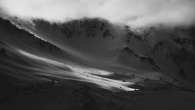
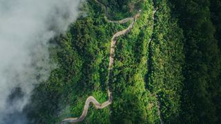
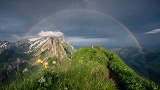

# 内置壁纸与许可

仅打包五张 Unsplash 照片。逐张原页面已核对作者与「Free to use under the Unsplash License」标记。

图片遵循 [Unsplash License](https://unsplash.com/license)，不属于项目代码的 MIT 授权。可免费复制、修改及分发用于本桌面；不得将未作显著修改的照片单独出售，或汇编成与 Unsplash 相似或竞争的服务。

**开发者自用的收藏壁纸不会随源码分发。** `.gitignore` 精确列出了上面五个文件名，
往 `bundled/` 里新增的图片默认被忽略，不会误提交；`catalog.json` 同步收录全部条目。
想换成自己的照片，用 `scripts/prepare_wallpapers.py` 生成到被忽略的 `local/` 目录即可。

| 预览 | 桌面名称 | 摄影师 | 原始页面 |
| --- | --- | --- | --- |
|  | 雾中雪岭 | [Arina Avdzhian](https://unsplash.com/@yallwacky) | [Unsplash](https://unsplash.com/photos/a-black-and-white-photo-of-a-snow-covered-mountain-rSYsP5TlEAk) |
|  | 雨林山路 | [Geio Tischler](https://unsplash.com/@oww) | [Unsplash](https://unsplash.com/photos/a-winding-road-in-the-middle-of-a-forest-hqzyUL3M21k) |
|  | 热带绿叶 | [Łukasz Rawa](https://unsplash.com/@lukasz_rawa) | [Unsplash](https://unsplash.com/photos/green-leaves-and-foliage-create-a-dark-and-lush-scene-4axNezh03UA) |
|  | 山间彩虹 | [Pascal Debrunner](https://unsplash.com/@debrupas) | [Unsplash](https://unsplash.com/photos/a-rainbow-arches-over-a-majestic-mountain-landscape-vwFvhJf6u_I) |
|  | 流光花影 | [Patrick Shaun](https://unsplash.com/@xiexianghua) | [Unsplash](https://unsplash.com/photos/a-blurry-photo-of-a-bunch-of-flowers-JtF_FvXVQQI) |

五张原图合计 18,776,212 bytes；显示副本与缩略图共 1,923,618 bytes，缩减 89.8%。

处理：显示副本最长边 1920 像素、JPEG quality 85；缩略图 320 × 180、quality 78；启用 optimize/progressive。原图不变，副本不写入 EXIF 或 GPS 信息。默认每 5 分钟顺序轮播，固定选择功能不变。

作者与来源也记录在 APK 内的 `assets/wallpapers/catalog.json`；资源大小、尺寸及校验值见 [媒体索引](../app/src/main/assets/wallpapers/bundled/MEDIA-INDEX.md)。
